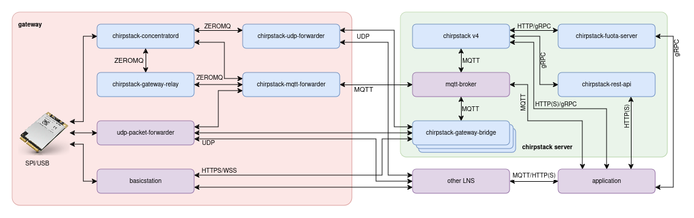

# ChirpStack UDP Forwarder service for Docker

This is an **unofficial** build of the ChirpStack UDP Forwarder service meant to be deployed using docker. The binaries included with this image are built from the chirpstack-udp-forwarder fork at https://github.com/xoseperez/chirpstack-udp-forwarder and may have small differences with the original binaries (check the repo for more info).

Please refer to the original sources of the project whenever possible, contribute and donate to Orne for his great work: https://github.com/chirpstack/chirpstack-udp-forwarder

ChirpStack UDP Forwarder is an open-source LoRa(WAN) packet forwarder using UDP as transport protocol, part of the ChirpStack project. It requires a chirpstack-concentratord component in order to build a viable LoRaWAN gateway solution.



## Tags

Each release of the fork (`v<upstream version>-r<n>`) is published as:

Tag | Points to
--- | ---
`4.3.1-r1` | that release (never changes)
`4.3.1`, `4.3`, `4`, `latest` | the newest release

Every tag is a multi-arch image for `linux/amd64`, `linux/arm64` and `linux/arm/v7`, and Docker picks the right one. The per-architecture tags (`amd64-latest`, `aarch64-latest`, `armv7hf-latest`) are no longer published.

## Chirpstack UDP Forwarder service variables

These variables you can set them under the `environment` tag in the `docker-compose.yml` file or using an environment file (with the `env_file` tag).

Variable Name | Value | Description | Default
--- | --- | --- | ---
**`LOGGING_LEVEL`** | `STRING` | Log level (TRACE, DEBUG, INFO, WARN, ERROR) | `INFO`
**`TTI_REGION`** | `STRING` | The Things Network / The Things Industries cluster, used to build the default server host | `eu1`
**`TTI_TENANT`** | `STRING` | The Things Industries tenant, `ttn` meaning The Things Network | `ttn`
**`SERVER_HOST`** | `STRING` | UDP server host | `<TTI_REGION>.cloud.thethings.network`, or `<TTI_TENANT>.<TTI_REGION>.cloud.thethings.industries` for other tenants
**`SERVER_PORT`** | `INT` | UDP server port | `1700`
**`KEEPALIVE_INTERVAL`** | `INT` | How often to ping the server (in seconds) | `30`
**`SOCKET_NAME`** | `STRING` | Prefix of the IPC socket to connect to (same as in the `concentratord` service) | `concentratord`

To see the configuration a set of variables produces, without starting the forwarder:

```sh
docker run --rm -e SERVER_HOST=lns.example.com xoseperez/chirpstack-udp-forwarder bash start --render
```

## Use

Check the included `docker-compose.yml` file for a usage example.

## Building

The image packages the release tarballs of the fork; it compiles nothing. From the root of the repository:

```sh
# Get the binaries: build them, or download the tarballs of a release
make dist-x86_64-unknown-linux-musl
# gh release download v4.3.1-r1 --pattern 'chirpstack-*.tar.gz' --dir dist

docker buildx bake -f docker/docker-bake.hcl --load --set '*.platform=linux/amd64'
```

`dist/` must hold exactly one tarball per architecture being built; `--set '*.contexts.dist=<folder>'` takes them from another folder (outside the repository, also pass `--allow=fs.read=<folder>`). Set `REGISTRY` and `VERSION` to name the image differently, and use `--push` instead of `--load` to push it.

Releases are built, tested and pushed to Docker Hub by `.github/workflows/docker-release.yml`, when a fork release is published or when the workflow is run by hand.

## License

ChirpStack UDP Forwarder is distributed under the MIT license (and so is this repository). See LICENSE.
